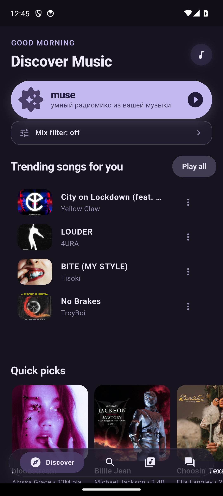
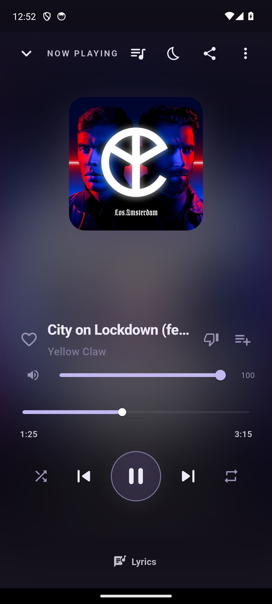

# Muse

**Музыкальный плеер для Android и Linux.** Поиск, своя библиотека, плейлисты, прослушивание без сети и управление из системы.

[**Скачать Android APK**](https://github.com/DmKOwO/muse-updates/releases/latest) · [Linux-сборки и история версий](https://github.com/DmKOwO/muse-updates/releases)

  
  

## Возможности

- Поиск музыки, библиотека, избранное, плейлисты и очередь воспроизведения.
- Загрузка треков по запросу пользователя для прослушивания без сети.
- Синхронные тексты песен и перемотка к выбранной строке.
- Синхронизация библиотеки между устройствами через Supabase.
- Медиаконтролы Android через MediaSession и интеграция Linux через MPRIS.
- Обновления из приложения через GitHub Releases.

## Попробовать

1. Откройте [последний выпуск](https://github.com/DmKOwO/muse-updates/releases/latest).
2. Для Android скачайте файл `.apk`; для Linux найдите архив `muse-linux-x64.tar.gz` в подходящем выпуске.
3. Откройте поиск, добавьте несколько треков в библиотеку и проверьте плеер и плейлисты.

Онлайн-поиск и синхронизация используют внешние сервисы. Загруженная музыка доступна без сети.

## Техническая сторона

**Dart · Flutter · Riverpod · SQLite · media_kit · Supabase**

Общая кодовая база для мобильного и настольного интерфейсов; локальная библиотека, фоновые операции, обработка аудиофокуса и интеграция с медиасистемой платформы.

Этот репозиторий содержит представление проекта, установочные сборки и манифест обновлений. Исходный код приложения здесь не публикуется.

## Обновления

[`manifest.json`](manifest.json) используется приложением для проверки версии и контрольной суммы APK. Подробности конкретной сборки находятся в [Releases](https://github.com/DmKOwO/muse-updates/releases).
